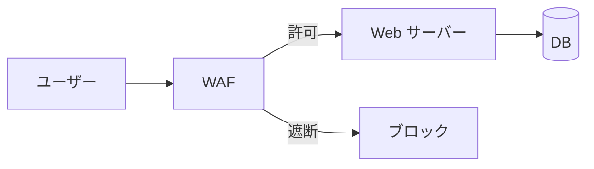
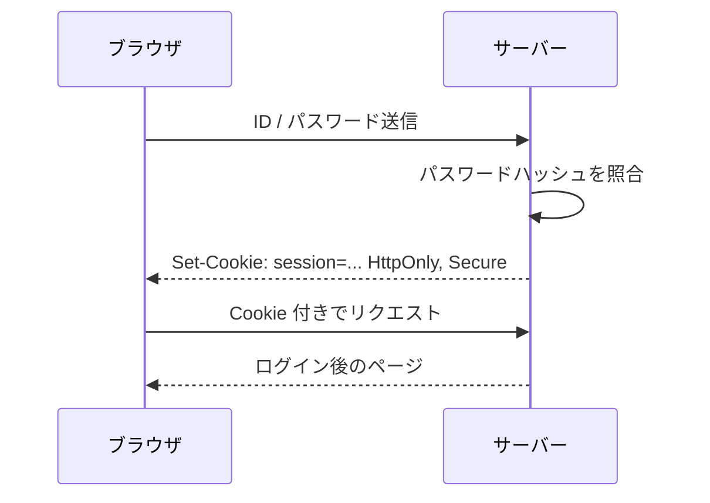

<!-- _class: lead -->
<!-- _paginate: false -->
<!-- _header: "" -->
<!-- _footer: "" -->

# Marp 機能確認用テストスライド

Markdown → スライドの変換結果を確認する

<!--
ここはスピーカーノート（発表者用メモ）です。
スライドには表示されず、発表者ビュー（キーボードの P）で確認できます。
-->

---

## 基本的な Markdown

- 箇条書き
  - ネストもできる
- **太字**、*斜体*、~~取り消し線~~、`インラインコード`
- [リンク](https://marp.app/)

1. 番号付きリスト
2. 2 つ目

> 引用ブロック：セキュリティは「最も弱い部分」で決まる

---

## コードブロック（シンタックスハイライト）

```python
import hashlib, os

def hash_password(password: str) -> str:
    salt = os.urandom(16)
    digest = hashlib.pbkdf2_hmac("sha256", password.encode(), salt, 600_000)
    return salt.hex() + ":" + digest.hex()
```

```bash
$ curl -I https://example.com
HTTP/2 200
strict-transport-security: max-age=31536000
```

---

## 表

| 脆弱性 | 概要 | 主な対策 |
| :-- | :-- | :-: |
| XSS | 悪意あるスクリプトの埋め込み | エスケープ / CSP |
| SQL インジェクション | 不正な SQL の実行 | プレースホルダ |
| CSRF | 意図しないリクエストの送信 | トークン / SameSite |

左寄せ・中央寄せは `:--` / `:-:` で指定

---

## Mermaid：ソースと描画結果

<div class="cols">
<div>

````markdown

````

</div>
<div>


</div>
</div>

---

## Mermaid：シーケンス図



---

## 数式（MathJax）

インライン：鍵長 $n$ ビットの総当たりは $2^n$ 通り

ブロック：

$$
H = L \log_2 N
$$

$H$：エントロピー（ビット）、$L$：パスワード長、$N$：使用する文字の種類数

---

## 画像

  

`` でサイズ指定、`grayscale` などのフィルタも使える

---


## 背景画像（右寄せ分割）

- `` で画面の右 40% に画像を配置
- `bg left` / `bg fit` / `bg contain` なども指定できる

---

<!-- _class: invert -->

## 色の反転（invert）

`<!-- _class: invert -->` をスライドに書くと、そのスライドだけ配色が反転する

先頭の `_` を外すと、それ以降のスライドすべてに適用される

---

<!-- _backgroundColor: #fef3c7 -->
<!-- _color: #78350f -->

## 背景色・文字色の変更

`<!-- _backgroundColor: #fef3c7 -->`
`<!-- _color: #78350f -->`

---

# <!-- fit --> 見出しを画面幅いっぱいに

---

## HTML で 2 カラム

<div class="cols">
<div>

### 左カラム

- 攻撃者の視点
- 脆弱性の発見

</div>
<div>

### 右カラム

- 防御者の視点
- 対策の実装

</div>
</div>

Front Matter の `style:` で CSS を書き、HTML タグで配置している

---

<!-- _class: lead -->

# 発表時の操作

**← →** でスライド移動 / **F** で全画面 / **P** で発表者ビュー

<!-- 発表者ビューでは、このようなメモと次のスライドが見られます。 -->
